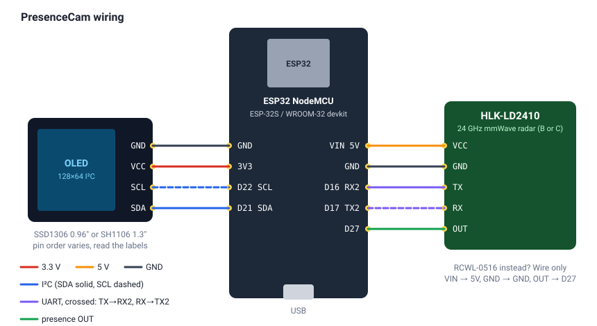

# PresenceCam

A room presence sensor built from an **ESP32 NodeMCU**, a **24 GHz radar** and a small **OLED**.
It shows whether someone is there, how far away they are, and keeps a **tamper-evident log**
of every arrival and departure that you can check from its web page.

**Install it from your browser, no tools needed: <https://OWNER.github.io/presencecam/>**
(Chrome or Edge on a computer.)



## Features

- **Radar presence** with an HLK-LD2410B/C (distance, moving and still targets, signal strength), or
  any radar with an on/off output such as the RCWL-0516.
- **OLED screen** (0.96" SSD1306 or 1.3" SH1106) with three pages: presence, network, device. The BOOT
  button flips between them.
- **Web dashboard** on your network: live status, event log, settings, Wi-Fi, firmware updates over the air.
- **Signed, chained event log**: every line carries an HMAC-SHA256 signature and links to the line
  before, so edited, deleted or reordered lines are flagged on the web page.
- **Easy setup**: the web flasher sends your Wi-Fi details over USB right after installing (Improv).
  Without it, the board opens a `PresenceCam-XXXX` setup network with a captive portal.
- **JSON API** (`/api/status`) for scripts and home automation.

## Parts

| Part | Notes |
|---|---|
| ESP32 NodeMCU (ESP-32S / ESP32-WROOM-32 devkit) | 30 or 38 pin, CP2102 or CH340 USB. Not the ESP8266 NodeMCU. |
| HLK-LD2410B or LD2410C radar *(recommended)* | Gives distance and sees people sitting still. RCWL-0516 works too, as on/off only. |
| 128×64 I²C OLED, 4 pins | SSD1306 0.96" or SH1106 1.3". |
| Jumper wires, USB data cable | |

## Wiring

| Module pin | ESP32 pin |
|---|---|
| OLED VCC | 3V3 |
| OLED GND | GND |
| OLED SDA | D21 |
| OLED SCL | D22 |
| LD2410 VCC | VIN (5 V) |
| LD2410 GND | GND |
| LD2410 TX | D16 (RX2) |
| LD2410 RX | D17 (TX2) |
| LD2410 OUT | D27 |
| RCWL-0516 VIN / GND / OUT | VIN / GND / D27 |

The pins are set in [`src/config.h`](src/config.h) if you need to change them.

## Install

### From the browser (easiest)

1. Open the [web flasher](https://OWNER.github.io/presencecam/) in Chrome or Edge.
2. Plug in the board, click **Connect & install**, pick the port.
3. When it finishes, enter your Wi-Fi name and password. The OLED shows the board's address.

### With PlatformIO

```sh
pio run -t upload        # build and flash
pio device monitor       # serial console, type "help"
```

### With esptool

Download `presencecam-merged.bin` from the [releases](../../releases) and write it at offset 0:

```sh
pip install esptool
esptool.py --chip esp32 write_flash 0x0 presencecam-merged.bin
```

## Using it

- **OLED:** *PRESENT* / *clear*, distance, moving and still energy, visits today. Short-press **BOOT**
  for the network page (IP address, signal) and the device page (version, radar type, uptime).
- **Blue LED:** lit while someone is present.
- **Hold BOOT 5 s:** forget Wi-Fi and reopen the setup network.
- **Web page** (`http://<ip>/` or `http://presencecam-xxxx.local/`):
  - **Hold time:** how long it stays *present* after the last detection.
  - **Max distance:** LD2410 only. Ignores targets further away, which helps when the radar sees through walls.
  - **OLED type:** SSD1306 or SH1106, and upside down.
  - **OLED sleep:** turns the screen off when nobody is there.
  - **Firmware:** upload `presencecam-ota.bin` to update without a cable.

### Serial console

At 115200 baud (PlatformIO monitor, or **Logs & console** in the web flasher):

```
status            firmware, radar, presence, Wi-Fi, OLED, log
radar [s]         live radar readings for s seconds
log [n]           last n log lines
verify            check the log chain
join SSID PASS    join a network
forget            forget Wi-Fi
name / hold / maxcm / oled ssd1306|sh1106|flip
factory YES       erase everything, including the log key
```

### API

| Endpoint | |
|---|---|
| `GET /api/status` | Live JSON: `present`, `radar.distanceCm`, energies, Wi-Fi, settings |
| `GET /api/log?n=50` | Last n log lines |
| `GET /api/log.txt` | Whole log as a download |
| `GET /api/verify` | Chain check result |
| `POST /api/settings` | Form fields `name hold maxcm oledsleep oleddrv oledflip` |
| `POST /api/wifi` | Form fields `ssid pass` |
| `POST /update` | Firmware `.bin` upload |

## The event log

Each event (boot, present, clear, wifi, settings, update) is one line in the board's flash:

```
n|unix_time|uptime_s|event|detail|prev|mac
42|1791712345|3605|clear|after 87 s|4be1…|91c0…
```

`mac` is an HMAC-SHA256 of the rest of the line, keyed with a random secret the board generates the
first time it starts. `prev` is the previous line's `mac`. The line counter is kept separately from
the file. So the **Verify** check catches changed lines, removed lines, reordered lines, and an
emptied log. The log rotates at about 48 KB, keeping the previous file, so the oldest kept line
then starts mid-chain, which the check reports as expected.

This protects the log against edits through the web page and in downloaded copies. Someone with
the board in hand can read the key out of the flash, so it isn't proof against that. Erasing the
board (web flasher "erase", or `factory YES`) makes a new key and starts again at line 1.

## Project layout

```
src/
  main.cpp       setup/loop, BOOT button
  config.h       pins and defaults
  radar.*        LD2410 UART parser + OUT pin
  presence.*     hold time, present/clear events
  display.*      OLED pages (U8g2)
  eventlog.*     signed, chained log in LittleFS
  net.*          Wi-Fi, setup access point, mDNS, Improv Serial
  web.*          web server and API; web_page.h is the dashboard
  console.*      serial commands
  settings.*     settings in NVS
site/            web flasher page (ESP Web Tools)
tools/           build helpers: version, merged image, site assembly
docs/wiring.svg
legacy-s3/       notes from the original ESP32-S3 camera version
```

## Releases and the web flasher

GitHub Actions ([`.github/workflows/build.yml`](.github/workflows/build.yml)) builds every push. On
`main` it publishes the web flasher to GitHub Pages; on a `v*` tag it attaches the binaries to the
release. To make a release, bump [`VERSION`](VERSION), commit, then `git tag v2.0.1 && git push --tags`.

First-time setup of a fork: **Settings → Pages → Source: GitHub Actions**.

To try the flasher locally: `pio run && python tools/make_site.py && python -m http.server -d _site`,
then open <http://localhost:8000> (Web Serial needs https or localhost).

## History

PresenceCam started as a battery-powered motion **camera** on a Waveshare ESP32-S3-LCD-1.47B:
PIR wake, an Arducam Mega 3MP, a VL53L0X distance sensor, photos to SD card, and the same signed
log idea so photos couldn't be quietly deleted. Version 2 swaps that for parts that are cheap and
easy to get: a NodeMCU, a radar and an OLED. The original notes are in [`legacy-s3/`](legacy-s3/).
