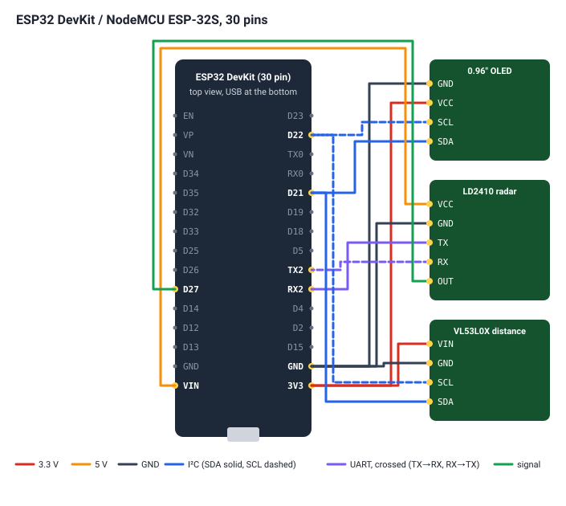

# PresenceCam

Show sensor readings on a small screen and on the web, detect presence, and keep a
**tamper-evident log** of who came and went, on an ESP32 board.

You pick your **board**, **display**, **sensors** and **screen layout** in the web flasher. It
works out which pin each wire goes to, draws the wiring diagram, installs the firmware and
sends your setup to the board. Nothing to compile, no pins to edit.

**Web flasher: <https://tdhydra.github.io/presencecam/>** (Chrome or Edge on a computer)



## Supported hardware

| | Supported now | Notes |
|---|---|---|
| **Boards** | ESP32 DevKit / NodeMCU ESP-32S (30 pin) | DOIT DevKit V1 layout |
| | ESP32 DevKitC / NodeMCU-32S (38 pin) | Espressif DevKitC V4 layout |
| | Waveshare ESP32-S3-LCD-1.47B | Built-in 1.47" LCD and RGB LED. Header order is drawn as a schematic, so wire by the printed GPIO numbers. |
| | Waveshare ESP32-S3-LCD-1.69 | Built-in 1.69" LCD, RTC, IMU, buzzer and battery charger. V2 board pinout. Holds its own power on when running from the battery. |
| | Waveshare ESP32-P4-ETH / ESP32-P4-POE-ETH | Wired Ethernet (PoE on the POE version) with DHCP, no Wi-Fi. No user LED or page button. Chip revisions v1.x and v3.x have separate firmware; the flasher asks which one. |
| | Waveshare ESP32-S3-ETH / POE-ETH | W5500 Ethernet (PoE with the module) or Wi-Fi, your choice. Leave the camera connector empty: its pins go to sensors. |
| | Waveshare ESP32-P4-Module-DEV-KIT | Ethernet (IP101) or Wi-Fi through its ESP32-C6 (ESP-Hosted). Pi-style 2×20 header, drawn as a schematic. |
| | Waveshare ESP32-C6-LCD-1.47 | Built-in 1.47" LCD and RGB LED. |
| | Seeed XIAO ESP32-C3 / ESP32-C6 | Pins labelled D0–D10. One spare UART. The C6's antenna switch is set to the built-in antenna. |
| | AI-Thinker ESP32-CAM (on the ESP32-CAM-MB) | Camera not used. Only four free GPIOs (2, 13, 14, 15), so an OLED plus a sensor with UART and OUT doesn't fit. |
| **Displays** | 0.96" SSD1306 OLED 128×64 (I²C) | Also works: 1.3" SH1106 (`"type":"sh1106"`) |
| | Built-in ST7789 LCD 172×320 / 240×280 | On the Waveshare 1.47B / 1.69 |
| **Sensors** | HLK-LD2410 / LD2410B / LD2410C 24 GHz radar | UART (distance, moving/still energy) and/or OUT pin (presence) |
| | VL53L0X laser distance (ToF) | I²C, shares the wires with the OLED. Can also count as presence below a set distance. |
| | VL53L1X laser distance (ToF, ~4 m) | Like the VL53L0X with longer range. Same I²C address, so fit one or the other. |
| | HC-SR04 ultrasonic distance | TRIG + ECHO pins, 2–400 cm. ECHO is 5 V on the plain HC-SR04: use a divider. Can count as presence below a set distance. |
| | HC-SR501 PIR motion | One digital pin (presence while it sees movement). 5 V supply, 3.3 V output. Ignored for the first minute while it settles. |
| **Layouts** | Basic | One row per reading with bars, presence on top, extra pages for more rows |
| | Big numbers | One reading per page, as large as the screen allows |
| | Tiles | A dashboard grid, every reading in its own tile |
| | Graph | Each reading with a graph of the last few minutes, plus a presence timeline |
| **Cameras** | Arducam Mega (SPI), AI-Thinker ESP32-CAM, ESP32-P4 MIPI-CSI | Optional. Photos are taken by rules (below) or from the web page and kept on the board. |

## How it works

```
catalog/*.json ──► web flasher (site/) ──► hardware config JSON ──► built into the firmware image
boards, sensors,   pick parts, readings,      {"board":…, "i2c":…,     in the browser; the firmware
displays, layouts  web page, allocate pins    "sensors":[…], "web":…}  reads it at boot
```

1. **Catalog** ([`catalog/`](catalog/)): one JSON file per board, sensor, display and layout. It
   holds header pin positions, which pins are off-limits, default I²C/UART pins, and how each part
   is wired.
2. **Configurator** ([`site/`](site/)): pick the board, display, layout, sensors and camera, then
   what each reading shows on (screen, web page, both or neither) and how the board's web page
   looks (title, light/dark, accent colour, cards/list/big numbers, which sections it shows).
   [`allocator.mjs`](site/allocator.mjs) gives every wire a GPIO. I²C parts share one pair, UART
   parts get a free hardware UART, and plain signals get the first safe pin. Flash, PSRAM, USB and
   on-board pins are never used, and problems are explained. [`wiring.mjs`](site/wiring.mjs) draws
   the diagram.
3. **Firmware made for the setup**: [`generate.mjs`](site/generate.mjs) takes the prebuilt image
   for the board's chip and writes the setup into an 8 KB block the firmware reserves for it
   (`pcamEmbeddedConfig` in [`hwconfig.cpp`](src/hwconfig.cpp)), then fixes the image checksum and
   SHA-256. No build server: it all happens in the browser in a fraction of a second.
4. **Install**: ESP Web Tools flashes that image over USB, then sets up Wi-Fi (Improv). Boards with
   Ethernet (ESP32-P4-ETH, ESP32-S3-ETH) use it instead of Wi-Fi. For ESP32, ESP32-S3 and ESP32-C3
   boards you can pick the Arduino core: 3 (default, needed for Ethernet) or the older core 2
   (Wi-Fi only). The ESP32-C6 and ESP32-P4 always use core 3. Already installed? Download the
   update `.bin` for the setup and upload it on the board's web page; Wi-Fi and settings stay.
5. **At boot** the firmware checks the built-in setup (pins exist, aren't taken twice, aren't
   flash/USB) and uses it the first time that image runs. A setup sent later over USB
   (`config set {…}`, the flasher's *Send setup* button) replaces it until the next image with a
   different built-in setup.

The firmware ([`src/`](src/)) has no pin numbers built in, only a default per chip. On an ESP32
that's the original wiring: OLED on 21/22, LD2410 on 16/17/27. On an ESP32-S3 it's the Waveshare
1.47B's LCD, and on an ESP32-P4 it's the Waveshare ESP32-P4-ETH with nothing attached.

## Rules

On the device's web page, *Rules* does things when a reading crosses a value: **take a photo**
(with a camera fitted), **light the status LED** while the condition holds, or **write a log
line**. A rule names a reading (as labelled on the page, or *presence*), a comparison (below,
above, is yes/no), a value, and the least time between two firings. Rules fire when the
condition becomes true, not on every loop. The console command `rules` shows how often each
fired.

## Buttons

| Press | Does |
|---|---|
| BOOT, short | Next screen page |
| BOOT, double | Dim / brighten the screen |
| BOOT, hold 3 s | Show the web address and a QR code |
| BOOT, hold 10 s | Forget Wi-Fi, restart into setup |
| RST, once | Restart |
| RST, 2× quickly | Open the `PresenceCam-XXXX` setup network for 10 minutes |
| RST, 3× quickly | Safe mode for one boot: built-in default setup, no sensors |

While BOOT is held, the screen shows what letting go now will do and a bar until the next action.
Holding BOOT during reset or power-up still enters download mode, for flashing. RST cuts the chip
off completely, so the firmware counts quick restarts instead of reading the button. The BOOT
actions can be changed in the hardware config:
`"buttons":{"short":"next","double":"dim","hold3":"info","hold10":"forget_wifi"}`. The possible
actions are `none next dim info forget_wifi setup_ap reboot`.

## Power

The Wi-Fi radio pulls 300–500 mA spikes when it starts. On a weak USB supply, many NodeMCU boards
brown out and reset. The firmware handles this itself
([power.h](src/power.h)). After one brownout reset, Wi-Fi restarts at 8.5 dBm. After a second,
Wi-Fi stays off for that start with a message on screen, while the screen, sensors and console keep
working. If low power turns out stable, auto mode keeps using it. The `boot` log line is only
written after 10 s of uptime, so a reset loop doesn't wear the flash. The real fixes are a better
cable or charger, or a 470–1000 µF capacitor across 3V3 and GND. Wi-Fi power can also be set by
hand (web page, or `txpower auto|19.5|15|11|8.5` in the console).

## Using it

- **Screen**: the layout's pages, then *Network* (IP, signal) and *Device* (version, board, uptime).
- **Web page** (`http://<ip>/` or `http://presencecam-xxxx.local/`): live readings, the event log
  with a *Verified* badge, the hardware in use (pins), settings (name, hold time, LD2410 max
  distance, screen flip and sleep), Wi-Fi, firmware update over the air.
- **Status LED**: lit while someone is present (amber on the Waveshare RGB LED).

### Serial console (115200 baud)

```
status            firmware, sensors, presence, Wi-Fi, display, log
sensors [s]       live readings for s seconds
config            show the hardware config and its pins
config set {...}  replace it (what the web flasher sends), then restart
config reset      back to this chip's default
log [n] · verify  the event log and its chain check
join SSID PASS · forget · setup · name · hold · maxcm · flip · reboot · factory YES
```

### API

| Endpoint | |
|---|---|
| `GET /api/status` | Live JSON: `present`, `readings[]` (`label value unit valid max`), sensor status, Wi-Fi, settings |
| `GET /api/hardware` | The hardware config and the GPIO for each connection |
| `GET /api/log?n=50` · `/api/log.txt` | Log lines / the whole log |
| `GET /api/verify` | Chain check result |
| `POST /api/settings` | `name hold maxcm screensleep screenflip` |
| `POST /api/wifi` | `ssid pass` |
| `POST /update` | Firmware `.bin` (`presencecam-<chip>-ota.bin`) |

## The event log

Each event (boot, present, clear, wifi, settings, hardware, update) is one line in flash:

```
n|unix_time|uptime_s|event|detail|prev|mac
```

`mac` is an HMAC-SHA256 of the rest of the line, keyed with a random secret the board makes on its
first start. `prev` is the previous line's `mac`, and the line counter is stored separately. So
changed, removed or reordered lines are caught, and so is an emptied log. It protects against edits
through the web page and to downloaded copies, not against someone who reads the key out of the
chip's flash. Erasing the board starts a new key at line 1.

## Adding hardware

- **A board** with an ESP32, ESP32-S3, ESP32-C3, ESP32-C6 or ESP32-P4: add `catalog/boards/<id>.json` (see
  [catalog/README.md](catalog/README.md)). No firmware change.
- **A sensor**: write a driver class in `src/sensors/` implementing `Sensor`
  ([sensor.h](src/sensors/sensor.h)). Add it to `makeSensor()`, accept its type in
  `validate()` ([hwconfig.cpp](src/hwconfig.cpp)), and add `catalog/sensors/<id>.json`.
- **A display**: a `Gfx` backend in `src/display/` ([gfx.h](src/display/gfx.h)), plus its type
  in `displayBegin()` and `validate()`, plus `catalog/displays/<id>.json`.
- **A layout**: a `Layout` in `src/layouts/` ([layout.h](src/layouts/layout.h)), listed in
  `layoutFind()` and `validate()`, plus `catalog/layouts/<id>.json`.

Then run the tests: `node --test site/test/*.test.mjs`. Among other things, they check that every
board × display × sensor combination gets conflict-free pins, and that the firmware's built-in
defaults match what the configurator produces.

## Building

```sh
tools/build.sh               # tests, every image (core 3: all chips, core 2: ESP32, S3, C3), site in _site/
tools/build.sh --publish     # the same, then release it on GitHub (see Releasing)
pio run                      # just the core 3 images; in .pio/build/<env>/presencecam-merged.bin
pio run -e esp32 -t upload   # flash an ESP32 board directly
node --test site/test/*.test.mjs
tools/serve.sh               # build, test and serve the flasher on port 8765
```

**Testing locally:** `tools/serve.sh` builds every chip, runs the tests and serves the flasher at
`https://<this machine>:8765` with a self-signed certificate (USB in the browser needs https). The
browser warns once: *Advanced → Proceed*.

**Releasing:** bump [`VERSION`](VERSION), commit, then `tools/build.sh --publish`. After the tests and
the build it pushes `main`, tags `vX.Y.Z`, creates the GitHub release with the firmware images and
deploys the flasher to GitHub Pages (the `gh-pages` branch). Everything runs on your machine, so it
uses no GitHub Actions minutes; it needs `gh` logged in. The Actions workflow
([build.yml](.github/workflows/build.yml)) only runs when started by hand.

## Project layout

```
catalog/          boards, sensors, displays, layouts (JSON)
site/             web flasher: index.html, allocator.mjs, wiring.mjs, serial.mjs, configurator.mjs, test/
src/
  main.cpp        startup and main loop
  hwconfig.*      the hardware config: defaults, validation, storage
  sensors/        Sensor interface + LD2410, VL53L0X
  display/        Gfx interface + OLED (U8g2) and ST7789 (LovyanGFX) backends; display.cpp runs pages
  layouts/        Basic layout
  buttons.*       BOOT gestures and RST multi-tap
  presence.*      hold time, present/clear events, status LED
  eventlog.*      signed, chained log
  net.*           Wi-Fi or Ethernet (ESP32-P4), setup network, mDNS, Improv
  web.*           web page and API (web_page.h is the dashboard)
  console.*       serial commands
tools/            version, merged image, site assembly
legacy-s3/        notes from the original ESP32-S3 camera version
```

## History

PresenceCam started as a battery-powered motion **camera** on the Waveshare ESP32-S3-LCD-1.47B:
PIR wake, an Arducam Mega 3MP, a VL53L0X, photos to SD card, and the same signed log so photos
couldn't be quietly deleted. Its notes are in [`legacy-s3/`](legacy-s3/).
